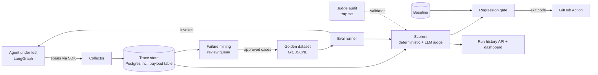
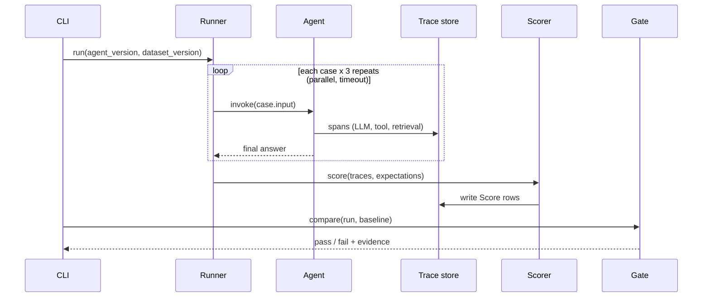
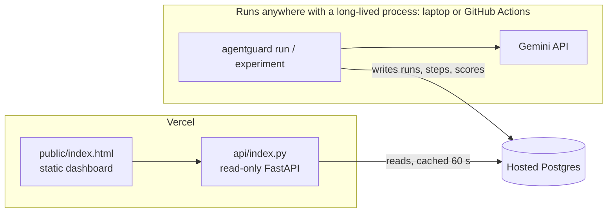

# AgentGuard: Architecture

## Overview
The agent emits spans to a collector. A runner replays golden cases against the agent. Scorers read the stored traces. A gate compares scores with a baseline and decides pass or fail. Failures seen in real use flow back into the dataset after review.

## Components
| # | Component | Responsibility | Package |
| --- | --- | --- | --- |
| 1 | Instrumentation SDK | Wrap agent nodes and tools; emit OpenTelemetry spans | `agentguard.sdk` |
| 2 | Collector and trace store | Receive spans, persist them; large payloads go in a separate content-addressed table | `agentguard.collector` |
| 3 | Golden dataset | Load and validate versioned cases | `agentguard.datasets` |
| 4 | Eval runner | Run cases in parallel with timeouts and repeats | `agentguard.runner` |
| 5 | Scorers | Deterministic checks, then LLM judge for open-ended answers | `agentguard.scorers` |
| 6 | Judge audit | Measure the judge against known verdicts | `agentguard.judge_audit` |
| 7 | Regression gate | Compare with baseline and set the CI exit code | `agentguard.gate` |
| 8 | Run history API | Serve scores, cost and latency trends | `agentguard.api` |
| 9 | Failure mining | Turn flagged traces into reviewed new cases | `agentguard.mining` |

## Evaluation run: sequence

## Implementation notes
- **Collector** is an in-process OpenTelemetry `SpanExporter` that writes Step rows, not a separate collector container. Same standard interface; an OTLP exporter can replace it later.
- **Baseline** is a JSON summary kept in Git (`baselines/main.json`), so moving the bar is a reviewed change and CI needs no database history. See ADR 0004.
- **Agent under test** is any `question -> answer` callable. The demo agent is LangGraph; the runner does not depend on it.
- **Runner** runs blocking agents in worker threads under asyncio, with a semaphore for concurrency and a timeout per attempt.

## Deployment shape (Vercel)
Two halves with a database between them. See [ADR 0006](adr/0006-serverless-deployment.md).

- **Evaluation never runs on Vercel.** Serverless functions have short time limits and no persistent disk; an evaluation is a long batch job.
- **The web side is read-only and slim.** It installs only the core dependencies (SQLAlchemy, psycopg, FastAPI, pydantic), not LangGraph or the model SDKs.
- **Responses are CDN-cached** (`s-maxage=60`) so the dashboard stays fast and the database quiet.

## Key design decisions
Each has a short record in [adr/](adr/).
- OpenTelemetry for spans, so the SDK is not locked to one vendor.
- Postgres for runs, steps, cases and scores; large prompts and outputs stored in a content-addressed payload table.
- Deterministic scorers first. The LLM judge is a fallback and is itself audited.
- Datasets in Git so a dataset change is reviewed like code.
- Three repeats per case; the unit of comparison is pass rate, not a single result.

## Failure handling
| Failure | Behaviour |
| --- | --- |
| Agent hangs | Per-case timeout; case scored as failed with reason `timeout` |
| Tracing backend down | SDK drops spans and logs a warning; the agent keeps working |
| Judge API error | Retry with backoff; if still failing, mark score `unknown` and do not count it as pass |
| Cost cap reached | Runner stops scheduling, run marked `partial`, gate refuses to pass a partial run |
