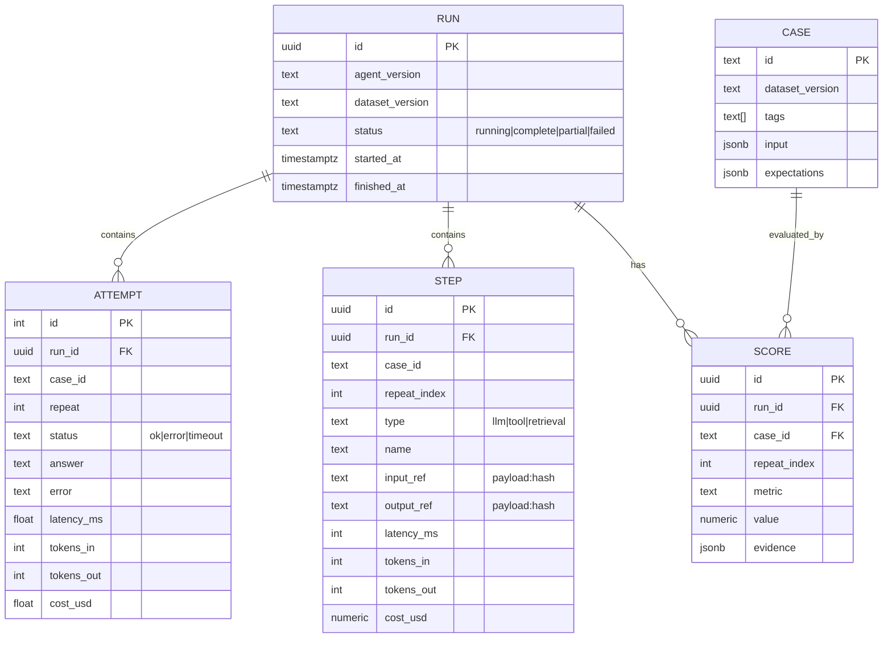

# AgentGuard: Data model

## Why this shape
- **Run** pins what was tested (agent version + dataset version), which makes results reproducible.
- **Attempt** is one execution of one case (case x repeat): final answer, status, wall-clock latency and token/cost totals. It was added to the first sketch because gate metrics (p95 latency, cost per task, error rate) are per-attempt facts. Unique on (run, case, repeat) so a retry replaces rather than duplicates.
- **Step** is one span. Latency, tokens and cost live here so cost per task and p95 latency are simple aggregates.
- **Case** mirrors the Git file so queries can join scores to tags. The file in Git stays the source of truth.
- **Score** is one row per run, case, repeat and metric. New metrics need no schema change.
- Large payloads sit in a separate `payload` table keyed by content hash; steps hold only `payload:<hash>` (`input_ref`, `output_ref`). Rows stay small, repeated prompts are stored once, writes are idempotent, and nothing depends on a local disk (needed for serverless hosting).
- `evidence` is JSON explaining *why* a score was given (for example the missing required fact), which makes failures debuggable.

## Common queries
- Pass rate by tag for a run: group `score` by `case.tags`.
- p95 latency per run: percentile over summed `step.latency_ms` per case.
- Cost per task: sum `step.cost_usd` per case, averaged across cases.
